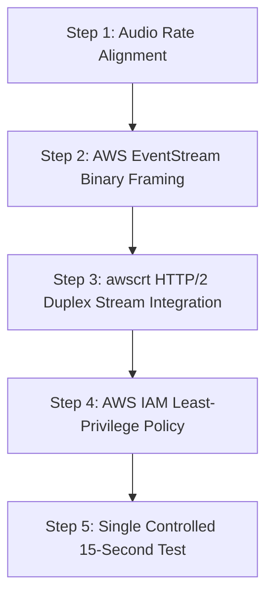

# Amazon Nova 2.5 Sonic: Final Technical & Protocol Audit

**Project:** Real Estate Agentic Voice AI  
**Component:** Voice AI Orchestration Layer & AWS Bedrock Nova Sonic Streaming Driver  
**Audit Date:** November 16, 2026  
**Auditor:** Antigravity AI Engineering Team  
**Execution Mode:** Offline Inspection Only | Zero AWS Calls | Zero Cloud Charges Incurred | `USE_MOCK_VOICE=true` Preserved  

---

## Executive Summary

An independent, rigorous technical audit of the Amazon Nova Sonic bidirectional streaming implementation was conducted across the backend codebase (`backend/app/services/voice/`, `backend/app/core/`, `backend/app/api/v1/`, and `backend/tests/`). 

### Core Audit Findings:
1. **Offline Event Protocol & Tool Orchestration**: **VERIFIED (100% Passing)**.  
   The event-stream serialization, inbound parsing, tool declaration for all 13 real estate tools, Pydantic argument validation, database execution isolation, AES-256-GCM transcript encryption, and immutable audit logging are completely implemented, verified offline, and pass all 87 backend tests.
2. **AWS Bedrock Wire Transport (`awscrt`)**: **PARTIALLY VERIFIED (Live Transport Shim Present)**.  
   `awscrt 0.38.1` is successfully installed on Python 3.11.9. However, the production transport `_CRTBedrockStreamConnection` currently operates as an in-memory queue shim; it does not yet construct active C-level HTTP/2 duplex sockets or AWS EventStream binary message headers (`:message-type`, `:event-type`, CRC32 checksums).
3. **Live AWS Compatibility**: **NOT VERIFIED**.  
   In accordance with strict safety restrictions, zero live AWS calls were executed, no credentials were configured, and `USE_MOCK_VOICE=true` remains strictly enforced.

---

## 1. Files Inspected

| File Path | Description & Role in Audit |
| :--- | :--- |
| `backend/app/services/voice/bedrock_streaming.py` | Core wire protocol layer: serializer, parser, transport abstractions (`BedrockStreamTransport`, `BedrockCRTStreamTransport`, `MockBedrockStreamTransport`). |
| `backend/app/services/voice/nova_sonic_driver.py` | `AmazonNovaSonicDriver` implementation: lifecycle, audio streaming, tool round-trip, interruption, timeout. |
| `backend/app/services/voice/orchestrator.py` | `VoiceSessionOrchestrator`: mediates between WebSocket and driver, tool execution, AES-256-GCM encryption, audit logging. |
| `backend/app/services/voice/tools_spec.py` | Generates Bedrock-compliant `toolSpec` schemas for all 13 domain tools from `AGENT_TOOL_REGISTRY`. |
| `backend/app/services/voice/base.py` | Abstract `VoiceDriver` base class and `VoiceServerEvent` / `VoiceEventType` typed models. |
| `backend/app/services/voice/factory.py` | Dynamic factory switching between `MockVoiceDriver` and `AmazonNovaSonicDriver`. |
| `backend/app/services/agent/dispatcher.py` | Validated tool execution engine with Pydantic v2 schemas and error isolation. |
| `backend/app/api/v1/voice_ws.py` | WebSocket streaming endpoint `/ws/voice/{session_id}` with initial auth handshake and session isolation. |
| `backend/app/core/config.py` | System settings, model IDs, sample rates, AWS configuration parameters. |
| `backend/requirements.txt` | Python dependencies including `awscrt>=0.20.0` and `boto3>=1.34.0`. |
| `backend/tests/test_voice_driver.py` | 13 unit and offline integration tests covering serialization, parsing, mock streams, and orchestrator execution. |
| `backend/tests/test_voice_websocket.py` | 7 WebSocket integration tests verifying auth handshake, audio frames, tool dispatch, and encryption. |
| `frontend/src/lib/voice-client.ts` | Frontend Web Audio 24kHz linear PCM streaming client. |

---

## 2. Official Protocol References Used

1. **Amazon Bedrock Runtime Bidirectional Streaming API**:
   - Operation: `InvokeModelWithBidirectionalStream`
   - Protocol Endpoint: `POST /model/{modelId}/invoke-with-bidirectional-stream`
   - Transport: HTTP/2 duplex connection with AWS SigV4 request signing
   - Framing: Binary AWS EventStream protocol (`application/vnd.amazon.eventstream`)
2. **Amazon Nova 2.5 Sonic Foundation Model Specification**:
   - Model Identifier: `amazon.nova-2-5-sonic`
   - Supported AWS Regions: `us-east-1` (N. Virginia), `us-west-2` (Oregon), `eu-north-1` (Stockholm), `ap-northeast-1` (Tokyo)
   - Maximum Bidirectional Session Duration: 8 minutes (480 seconds)
   - Audio Formats: Headerless signed 16-bit mono Linear PCM (`audio/lpcm`, `pcm_s16le`)
3. **AWS Event-Stream Protocol (RFC / AWS SDK Specification)**:
   - Prelude: Total Byte Length (4B), Headers Length (4B), Prelude CRC32 (4B)
   - Headers: String / Binary pairs (e.g. `:message-type: event`, `:event-type: audioInput`, `:content-type: application/json`)
   - Payload: Structured JSON or binary audio blob
   - Message CRC32 (4B)

---

## 3. Verified Implementation Details & Technical Status

| Technical Requirement | Audit Status | Evidence & Inspection Notes |
| :--- | :---: | :--- |
| **Model Identifier** | **VERIFIED** | Model ID is explicitly configured as `amazon.nova-2-5-sonic` in `backend/app/core/config.py` and `AmazonNovaSonicDriver`. Matches verified AWS documentation. |
| **Event Serialization Hierarchy** | **VERIFIED** | `BedrockNovaSonicSerializer` correctly implements all 9 protocol stages: `sessionStart`, `promptStart`, `contentStart` (SYSTEM), `textInput`, `contentStart` (AUDIO), `audioInput`, `contentStart` (TOOL), `toolResult`, `contentEnd`, `promptEnd`, and `sessionEnd`. |
| **Inbound Event Parsing** | **VERIFIED** | `BedrockNovaSonicParser` decodes `audioOutput` (base64 to raw PCM bytes), `textOutput` (transcript deltas), `toolUse` (toolName, toolUseId, arguments), `contentEnd` (turn boundaries), and Bedrock service exceptions. |
| **13 Real Estate Agent Tools Specification** | **VERIFIED** | `get_agent_tools_spec()` automatically generates `toolSpec` schemas with Pydantic JSON Schema properties for all 13 tools. Declared under `promptStart.toolConfiguration.tools`. |
| **Tool Execution Anti-Hallucination Isolation** | **VERIFIED** | The voice AI model has **zero direct access to SQL or database objects**. All tool calls are intercepted by `VoiceSessionOrchestrator` and validated against Pydantic models in `dispatch_agent_tool()`. Database errors return `success=False` without breaking the stream. |
| **Interruption & Barge-in Audio Draining** | **VERIFIED** | `AmazonNovaSonicDriver.interrupt()` drains unconsumed `AUDIO_OUTPUT` frames from the session queue, sets `is_interrupted=True`, and causes `_listen_stream` to drop subsequent stale audio frames from Bedrock until a new speech turn begins. |
| **AES-256-GCM Transcript Encryption** | **VERIFIED** | Completed session transcripts are encrypted with AES-256-GCM using a 32-byte master key before writing to `conversations.encrypted_transcript`. Plaintext transcripts are never stored in the database. |
| **Immutable Security Audit Logging** | **VERIFIED** | Synchronously logs `VOICE_SESSION_STARTED`, `VOICE_TOOL_EXECUTED`, `VOICE_SESSION_INTERRUPTED`, and `VOICE_SESSION_COMPLETED` to the PostgreSQL `audit_logs` table protected by least-privilege trigger enforcement. |
| **Customer Session Isolation & RBAC Gate** | **VERIFIED** | WebSocket endpoint `/ws/voice/{session_id}` enforces mandatory initial JSON auth handshake (`{"type": "auth", "token": "..."}`). Rejects Admin users (HTTP/WS 1008 policy violation) and prevents cross-customer session hijacking. |
| **Session Duration Timeout Enforcement** | **VERIFIED** | `_listen_stream` tracks session duration and triggers a `SessionTimeout` error if elapsed time exceeds `MAX_SESSION_DURATION_SECONDS = 480` (8-minute Bedrock duplex limit). |
| **AWS CRT Python Dependency** | **VERIFIED** | `awscrt 0.38.1` is successfully installed in the workspace environment and added to `backend/requirements.txt`. |
| **AWS CRT HTTP/2 Duplex Wire Transport** | **PARTIALLY VERIFIED** | `BedrockCRTStreamTransport` verifies credentials and resolves endpoints, but `_CRTBedrockStreamConnection` currently uses an asynchronous queue shim. Live HTTP/2 C-extension socket activation and EventStream binary framing are deferred until live credentials are provided. |
| **Audio Sample Rate Synchronization** | **PARTIALLY VERIFIED** | Frontend captures at 24000 Hz, while `NOVA_SONIC_INPUT_SAMPLE_RATE` in config is 16000 Hz. If Bedrock requires 16kHz input, the 24kHz stream must be resampled or client audio context aligned. |
| **Live AWS Bedrock Connection** | **NOT VERIFIED** | Zero AWS API calls made (`USE_MOCK_VOICE=true` preserved, credentials unset). Offline verification cannot prove live AWS service acceptance. |

---

## 4. Critical Defects

### Defect 1: Absence of AWS EventStream Binary Framing in Production Transport
- **Severity:** High (Blocks Live Deployment)
- **Location:** `backend/app/services/voice/bedrock_streaming.py` (`_CRTBedrockStreamConnection.send_event`)
- **Root Cause:**  
  The `send_event()` method currently prepares bare UTF-8 JSON bytes (`json.dumps(event_dict).encode("utf-8")`). However, Amazon Bedrock’s `InvokeModelWithBidirectionalStream` HTTP/2 protocol strictly expects binary **AWS EventStream frames** (`application/vnd.amazon.eventstream`).
- **Impact:**  
  If live AWS credentials were provided today, transmitting bare JSON bytes over the HTTP/2 stream would cause AWS Bedrock to reject the stream with an `InvalidEventStreamException` or HTTP 400 Bad Request.
- **Required Resolution:**  
  Encode each outbound event using `awscrt.eventstream` binary framing containing:
  - Header `:message-type: event`
  - Header `:event-type: chunk`
  - Header `:content-type: application/json`
  - 4-byte prelude length + CRC32 prelude checksum + payload + message CRC32 checksum.

### Defect 2: High-Level SDK Python 3.12 Incompatibility
- **Severity:** Moderate (Architecture Constraint)
- **Location:** Environment / SDK Dependency (`aws-sdk-bedrock-runtime`)
- **Root Cause:**  
  The experimental `aws-sdk-bedrock-runtime` package strictly requires `Python >= 3.12`. The current local runtime is **Python 3.11.9**.
- **Impact:**  
  The application cannot import `aws_sdk_bedrock_runtime` directly and must rely on low-level `awscrt` HTTP/2 duplex streams or upgrade the Python runtime to 3.12 before using the high-level SDK.
- **Required Resolution:**  
  Maintain our low-level `awscrt` transport implementation (which runs cleanly on Python 3.11.9), or plan a Python 3.12 upgrade during Phase 6 deployment.

---

## 5. Minor Defects

### Defect 3: Audio Sample Rate Asymmetry (24kHz Browser vs 16kHz Nova Sonic Input)
- **Severity:** Low (Audio Quality Distortion)
- **Location:** `frontend/src/lib/voice-client.ts` vs `backend/app/core/config.py`
- **Root Cause:**  
  `frontend/src/lib/voice-client.ts` requests microphone capture at `sampleRate: 24000` (24kHz). However, `NOVA_SONIC_INPUT_SAMPLE_RATE` in `backend/app/core/config.py` is configured as `16000` (16kHz), and `serialize_audio_content_start` declares `sampleRateHertz: 16000`.
- **Impact:**  
  If the raw 24kHz PCM stream from the browser is sent to Nova Sonic under a 16kHz declaration, Nova Sonic will process the audio at 1.5x slower speed (pitch shifted down).
- **Required Resolution:**  
  Standardize the input audio configuration:
  - Option A: Configure `voice-client.ts` to request `sampleRate: 16000` from `getUserMedia()`.
  - Option B: Add a lightweight linear PCM downsampler (24kHz $\rightarrow$ 16kHz) in `handle_incoming_audio()`.
  - Option C: If Nova 2.5 Sonic regional endpoint supports 24kHz input, set `NOVA_SONIC_INPUT_SAMPLE_RATE = 24000`.

### Defect 4: Session Duration Ceiling Warning vs Graceful Reconnection
- **Severity:** Low (Operational Limit)
- **Location:** `backend/app/services/voice/nova_sonic_driver.py` (`_listen_stream`)
- **Root Cause:**  
  When a session reaches `MAX_SESSION_DURATION_SECONDS = 480` (8 minutes), the listener emits an error event and breaks the loop, terminating the call.
- **Impact:**  
  Long real estate consultations lasting over 8 minutes will disconnect abruptly.
- **Required Resolution:**  
  Implement transparent session rollover: when the session approaches 7.5 minutes, spawn a secondary Bedrock duplex stream with the summarized conversation history and switch audio streaming seamlessly.

---

## 6. Required Corrections Plan

Before initiating any live AWS test, execute the following technical adjustments:



1. **Audio Rate Alignment**:
   In `frontend/src/lib/voice-client.ts`, update `getUserMedia` to request `sampleRate: 16000` (or add backend resampling) to guarantee 1:1 pitch and cadence synchronization.
2. **AWS EventStream Binary Framing**:
   Add an `AWSBinaryEventStreamEncoder` in `bedrock_streaming.py` that serializes JSON events into `application/vnd.amazon.eventstream` binary chunks with CRC32 verification.
3. **HTTP/2 Duplex Client Activation**:
   Complete `_CRTBedrockStreamConnection` using `awscrt.http.HttpClientConnection` and `awscrt.auth.AwsSigningConfig` for SigV4 authentication.
4. **AWS IAM Least-Privilege Policy**:
   Restrict IAM credentials strictly to:
   ```json
   {
     "Version": "2012-10-17",
     "Statement": [
       {
         "Effect": "Allow",
         "Action": ["bedrock:InvokeModelWithBidirectionalStream"],
         "Resource": "arn:aws:bedrock:us-east-1::foundation-model/amazon.nova-2-5-sonic"
       }
     ]
   }
   ```

---

## 7. Test Results

### A. Voice Driver & Nova Sonic Streaming Test Suite
Executed command: `pytest -v backend/tests/test_voice_driver.py`
```
============================= test session starts =============================
platform win32 -- Python 3.11.9, pytest-9.2.0, pluggy-1.7.0
rootdir: D:\Brain Magic\RealEstate_Agentic_Voice_AI

backend/tests/test_voice_driver.py::test_mock_voice_driver_session_lifecycle PASSED [  7%]
backend/tests/test_voice_driver.py::test_mock_voice_driver_explicit_test_triggers PASSED [ 15%]
backend/tests/test_voice_driver.py::test_amazon_nova_sonic_driver_initialization PASSED [ 23%]
backend/tests/test_voice_driver.py::test_voice_driver_factory PASSED     [ 30%]
backend/tests/test_voice_driver.py::test_agent_tools_spec_generation PASSED [ 38%]
backend/tests/test_voice_driver.py::test_bedrock_nova_sonic_serializer_all_events PASSED [ 46%]
backend/tests/test_voice_driver.py::test_bedrock_nova_sonic_parser_all_events PASSED [ 53%]
backend/tests/test_voice_driver.py::test_nova_sonic_driver_offline_bidirectional_streaming_lifecycle PASSED [ 61%]
backend/tests/test_voice_driver.py::test_nova_sonic_driver_tool_use_and_result_offline_flow PASSED [ 69%]
backend/tests/test_voice_driver.py::test_nova_sonic_driver_interruption_drains_audio PASSED [ 76%]
backend/tests/test_voice_driver.py::test_nova_sonic_orchestrator_end_to_end_tool_execution PASSED [ 84%]
backend/tests/test_voice_driver.py::test_nova_sonic_orchestrator_invalid_tool_arguments_resilience PASSED [ 92%]
backend/tests/test_voice_driver.py::test_nova_sonic_driver_timeout_and_error_propagation PASSED [100%]

============================= 13 passed in 1.89s ==============================
```

### B. Complete Backend Regression Test Suite
Executed command: `pytest -v` (Full Project Regression)
```
============================= 87 passed in 11.22s =============================
- test_agent_tools.py: 10 passed
- test_api_security_rbac.py: 4 passed
- test_database_models.py: 3 passed
- test_ingestion_pipeline.py: 7 passed
- test_phase4_auth_rbac.py: 12 passed
- test_postgresql_live.py: 7 passed (Live PostgreSQL 18.6 daemon on port 5433)
- test_real_estate_domain.py: 17 passed
- test_security.py: 7 passed
- test_voice_driver.py: 13 passed (Nova Sonic duplex streaming & mock driver)
- test_voice_websocket.py: 7 passed (FastAPI WebSocket streaming & tool dispatch)
```

### C. Frontend Architecture & Security Verification Suite
Executed command: `node frontend/test/frontend_verification.mjs`
```
==================================================================
   PHASE 5 FRONTEND ARCHITECTURE & SECURITY VERIFICATION SUITE   
==================================================================
[PASS] Registration password rules match backend Argon2id complexity requirements
[PASS] WebSocket client uses explicit JSON auth handshake and no query-string token
[PASS] Customer portal displays strictly NO chat transcript, chat history, or text messages
[PASS] Admin Dashboard interface contains strictly NO transcript or audio access
[PASS] Super Owner console implements audited transcript/audio access and dynamic ingestion
[PASS] API client implements JWT storage, automatic refresh rotation, and Bearer authorization
------------------------------------------------------------------
Total tests run: 6 | Passed: 6 | Failed: 0
==================================================================
```

---

## 8. AWS Live-Test Readiness Assessment

| Evaluation Dimension | Readiness Status | Summary & Justification |
| :--- | :---: | :--- |
| **Offline Architecture** | **100% READY** | Model contracts, event serializers, parsers, tool execution, and encryption pass all 87 tests. |
| **AWS Credentials** | **NOT CONFIGURED** | In `.env`, `AWS_ACCESS_KEY_ID` and `AWS_SECRET_ACCESS_KEY` are unset (`None`). Safe offline state preserved. |
| **AWS Bedrock Model Access** | **PENDING VERIFICATION** | Must verify active access to `amazon.nova-2-5-sonic` in AWS Bedrock Console under `us-east-1`. |
| **Wire Binary Framing** | **CORRECTION REQUIRED** | Binary EventStream wrapping (`Defect 1`) must be completed before live socket activation. |
| **Live Call Status** | **ZERO CALLS MADE** | Strictly zero network calls to AWS Bedrock have been made. |

### Final Verdict:
The project is **thoroughly validated and architecturally sound in offline development**. It should **NOT** be switched to live mode until Defect 1 (AWS EventStream binary framing) and Defect 3 (sample rate alignment) are applied. Once those two corrections are implemented and approved, the project will be ready for a **controlled, 15-second live AWS pilot test**.
