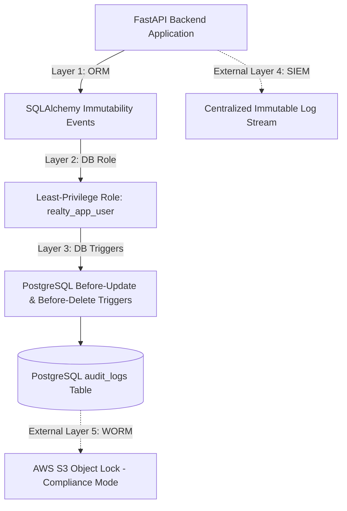

# Audit Log Hardening, Least-Privilege Roles & Immutability Limits

## 1. Overview
Audit logs in the Real Estate Agentic Voice AI platform record security-critical events, including privileged transcript decryption, raw audio streaming, dynamic dataset rollbacks, authentication attempts, and authorization decisions.

This document outlines the multi-layered security architecture protecting audit records, the least-privilege PostgreSQL role configuration, and an explicit analysis of the limits of database-level protection.

---

## 2. Multi-Layered Protection Architecture



### Layer 1: Application & ORM Immutability
- SQLAlchemy event listeners (`before_update` and `before_delete`) intercept any attempt by the application to modify or delete `AuditLog` objects, immediately raising `AuditLogTamperingError`.
- API endpoints strictly omit any `PUT`, `PATCH`, or `DELETE` operations on `/super-owner/audit-logs`.

### Layer 2: Database Least-Privilege Role Hardening
In production, the backend application connects using a dedicated non-superuser role (`realty_app_user`), not the database superuser (`postgres`).

```sql
-- Production Role Provisioning Script
-- 1. Create dedicated application role without superuser or DDL rights
CREATE ROLE realty_app_user WITH LOGIN PASSWORD 'strong_production_password_here';

-- 2. Grant connection and schema access
GRANT CONNECT ON DATABASE realestate_ai TO realty_app_user;
GRANT USAGE ON SCHEMA public TO realty_app_user;

-- 3. Grant default operational privileges to business tables
GRANT SELECT, INSERT, UPDATE, DELETE ON ALL TABLES IN SCHEMA public TO realty_app_user;
GRANT USAGE, SELECT ON ALL SEQUENCES IN SCHEMA public TO realty_app_user;

-- 4. HARDEN AUDIT LOGS: Explicitly revoke UPDATE, DELETE, and TRUNCATE
REVOKE UPDATE, DELETE, TRUNCATE ON TABLE audit_logs FROM realty_app_user;
GRANT SELECT, INSERT ON TABLE audit_logs TO realty_app_user;

-- 5. Restrict trigger function execution from public and application users
REVOKE ALL ON FUNCTION prevent_audit_log_tampering() FROM PUBLIC;
REVOKE ALL ON FUNCTION prevent_audit_log_tampering() FROM realty_app_user;

-- 6. Disallow DDL permissions for application runtime role
ALTER DEFAULT PRIVILEGES IN SCHEMA public REVOKE ALL ON TABLES FROM realty_app_user;
GRANT SELECT, INSERT, UPDATE, DELETE ON TABLES TO realty_app_user;
REVOKE UPDATE, DELETE, TRUNCATE ON TABLE audit_logs FROM realty_app_user;
```

### Layer 3: Database-Level Immutability Triggers
Even if a query runs with elevated privileges, PostgreSQL triggers enforce immutability:
```sql
CREATE OR REPLACE FUNCTION prevent_audit_log_tampering()
RETURNS TRIGGER AS $$
BEGIN
    RAISE EXCEPTION 'Audit logs are strictly immutable and cannot be updated or deleted.';
END;
$$ LANGUAGE plpgsql;

CREATE TRIGGER trg_audit_logs_prevent_update
BEFORE UPDATE ON audit_logs
FOR EACH ROW EXECUTE FUNCTION prevent_audit_log_tampering();

CREATE TRIGGER trg_audit_logs_prevent_delete
BEFORE DELETE ON audit_logs
FOR EACH ROW EXECUTE FUNCTION prevent_audit_log_tampering();
```

---

## 3. Explicit Limits of Database-Superuser Protection

> [!CAUTION]
> **No claim of absolute database immutability is made.**
> 
> A database superuser (such as `postgres` or an AWS RDS master user) possesses built-in capabilities that intentionally bypass access controls:
> 1. Superusers bypass Row Level Security (`BYPASSRLS`).
> 2. Superusers can disable triggers using `ALTER TABLE audit_logs DISABLE TRIGGER ALL;`.
> 3. Superusers can drop triggers, drop functions, or alter table schemas (`DROP TRIGGER`, `DROP TABLE`).
> 4. Operating-system or storage administrators with physical or hypervisor access can manipulate PostgreSQL Write-Ahead Logs (WAL) or data page files directly on disk.

Therefore, database triggers and role restrictions protect against:
- Application bugs and logic errors.
- Compromised backend application credentials (`realty_app_user`).
- SQL injection vulnerabilities within the application layer.
- Accidental administrative deletion during operational queries.

They **do not** prevent deliberate tampering by an authorized database superuser or cloud infrastructure administrator.

---

## 4. Production Non-Repudiation Beyond PostgreSQL

To guarantee non-repudiation against compromised database superusers in production environments, the platform relies on external complementary controls:

1. **Centralized Log Shipping (SIEM)**:
   Every audit entry created by `record_audit_log_sync` is simultaneously emitted to stdout/structured logging and synchronously forwarded to an external managed SIEM (e.g. AWS CloudWatch Logs or Datadog) with retention locks. Even if a PostgreSQL row is purged, the log record remains in the external vault.
2. **WORM Storage (Write Once, Read Many)**:
   Exported daily audit logs and conversation archives are stored in AWS S3 with **S3 Object Lock** enabled in **Compliance Mode**. In Compliance Mode, no user—including the AWS root account—can overwrite or delete objects until the legal retention period (e.g., 7 years) has elapsed.
3. **Cryptographic Chaining (Future Roadmap)**:
   In subsequent phases, audit entries can incorporate a SHA-256 hash chaining mechanism (`previous_record_hash`), generating a Merkle audit trail where any deleted or altered record breaks the cryptographic chain verification.
